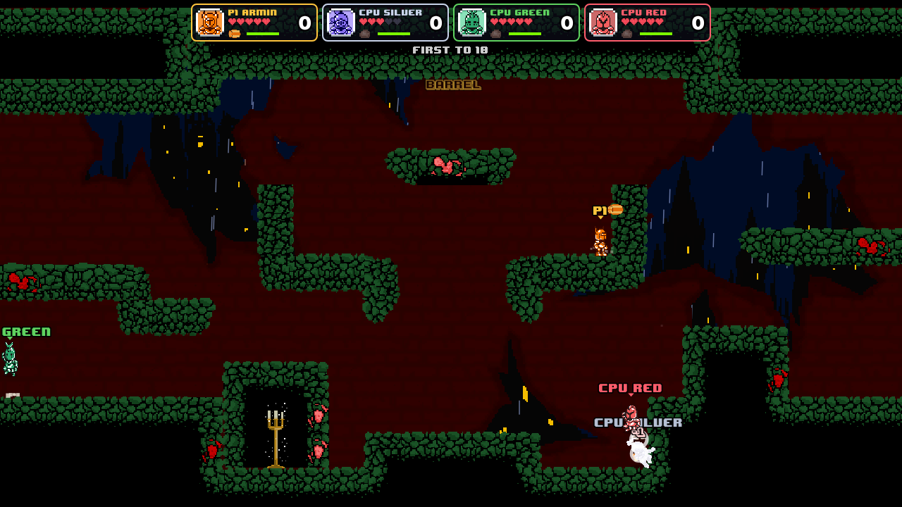
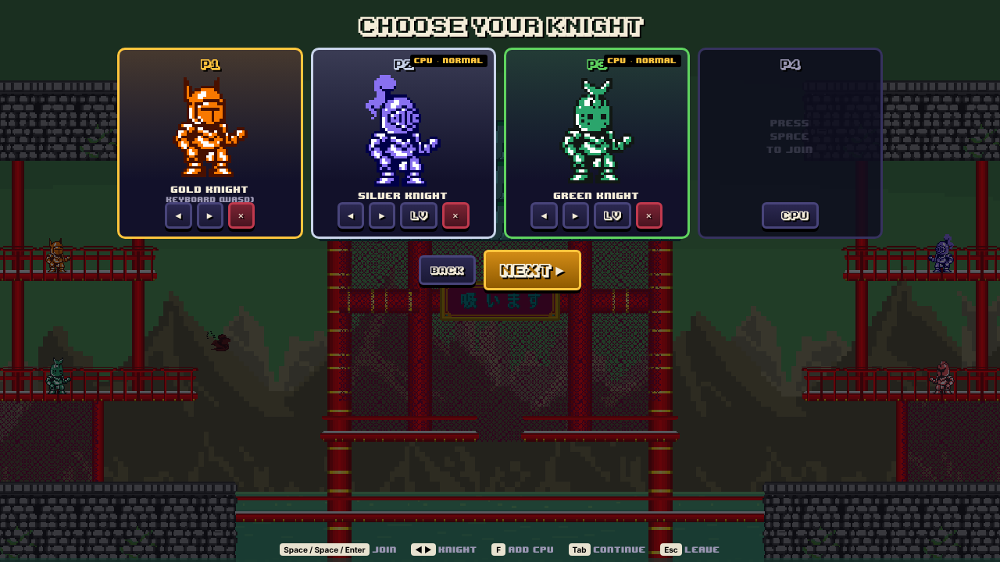
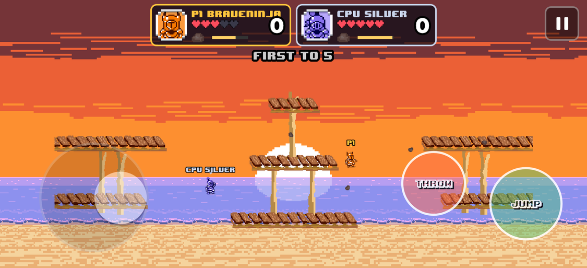

# Dungeon Crusade 🍕

A projectile arena brawler for 2-4 players. Rack up KOs by pelting your rivals
with stones, shurikens, pizza, rubber ducks, stinky socks and (sometimes) nukes.

**Version 2** is a from-scratch rebuild of the 2016 Unity game. It reuses all
of the original art, animations, sound, music, fonts and level layouts. It plays
on **PC (Steam / Windows / macOS / Linux), Android, iOS and the web**, offers
**couch versus for 2-4 players** and **online play with full crossplay**.



| Couch lobby | Mobile (touch controls) |
| --- | --- |
|  |  |

## What's in the game

- **3 arenas from the original**: Dungeon, Wacky Beach and Dragon Temple, extracted 1:1 from the Unity scenes.
  - Dungeon has barrel-breakable walls and a respawning armor candle.
  - Wacky Beach has jump-through piers, wrap-around edges and seagulls dropping chests.
  - In Dragon Temple, nuking the temple wakes a dragon that swoops through the arena.
- **10 weapons**, each with its own behaviour:
  - Stone, Pill (bounces), Shuriken, Fireball (eats small shots), Pizza.
  - Barrel (rolls, smashes walls), Stinky Sock (lobbed AoE), Rubber Duck (quack pulses).
  - Bomb (1 in 4 is a nuke, the rest is confetti) and Megaphone (three wavy notes).
- **Projectile PvP:** aim up and down, strong shots clash with and destroy weaker ones, knockback, armor chests, and head-stomps (footstool).
- **Modes:**
  - Couch versus with any mix of humans and CPUs (easy, normal or hard).
  - Free-for-all or 2v2 teams.
  - First-to-N KOs, optional time limit with sudden death.

### Two modes

- **Classic**: the original game's rules. Throw, dodge, and the first to the KO target wins.
- **Crusade ★**: a remix that fixes the original's weak spots (pick it on the stage screen, or as host in an online room).

| Problem in the original | Crusade's answer |
| --- | --- |
| No way to defend against a projectile | **Swing** your sword to parry shots back at whoever threw them, faster and glowing gold. The blade also shoves knights, and a parry refunds the swing. |
| Knockback never mattered (closed arenas) | **SPLAT!** Knights launched into walls, floors or ceilings take bonus damage, and the lower your health the further you fly. |
| Random weapons snowball the leader | Chest weapons have **ammo**, then it's back to the stone. Chests favour the **underdog**, and the leader wears a **crown** worth a +1 bounty. |
| Last hit steals the KO | Points: **KO = 2, assist = 1** (2+ damage dealt), self-KO = -1. |
| Four identical knights | **Perks:** Gold is Lucky (2x ammo, luckier loot), Silver is Swift, Green is Bouncy (triple jump), Red is Heavy (hard to launch). |
| Dungeon blocks sightlines; the dragon almost never appears | Dungeon walls **crumble** under fire. The Dragon Temple has health and can be shot down (or falls after 75 s), and the dragon then keeps swooping. |
| The Bomb's 75% dud does nothing | The confetti dud now **shoves** everyone nearby. |

Perks were balanced over 96 simulated 4-CPU matches (23/30/22/21 wins for Gold/Silver/Green/Red).

### Game feel (new in v2)

- Snappy movement with acceleration curves:
  - coyote time and jump buffering
  - variable jump height, apex hang and fast-fall
  - double jump, wall slide and wall jump
  - drop-through platforms
- Hit feedback:
  - per-fighter hitstop and a white hit-flash
  - damage numbers
  - KO freeze frames and slow-motion on the final KO
- Camera:
  - trauma-based screen shake
  - directional camera kick and zoom punches
  - a dynamic camera that frames the fighters
- Effects and audio:
  - squash and stretch
  - dust, sparks, confetti, debris and projectile trails, using the original FX sprite sheets
  - the original sounds with pitch variation, stereo panning and music ducking
- Controller rumble on gamepads, and haptics on phones.
- Optional player-coloured outlines around every knight (Settings), for readability in 4-player chaos.

## Controls

| | Move / aim | Jump | Throw | Swing (Crusade) | Pause |
| --- | --- | --- | --- | --- | --- |
| Gamepad (Xbox, PlayStation, Switch Pro, 8BitDo, generic) | Stick / D-pad | A / ✕ / B | X / □ / Y, RB, RT | B / ○ / A, Y / △ | Menu / Options / + |
| Keyboard P1 | WASD | Space / C | F / V | G / B | Esc |
| Keyboard P2 | Arrows | `.` / K | `/` / L | `,` / J | Backspace |
| Touch | Left half: floating stick | JUMP button | THROW button | SWING button | ⏸ |

In Classic there is no sword: the swing buttons act as extra throw buttons.

- Hold up or down while throwing to aim.
- Press Down + Jump to drop through a platform.
- Two players can share one keyboard.
- Every controller joins by pressing its jump button in the lobby.
- Button prompts adapt to the controller you use.

## Online play & crossplay

- Everyone connects to the same small relay server, so a phone, a Steam PC and a browser can play in one room.
- **Create Room** gives you a 4-letter code. Share it as a code, an invite link (`…/?join=ABCD`), the phone's share sheet, or a **Steam overlay invite**.
- **Quick Match** drops you into a public room.
- **Couch + online:** extra controllers on one device can join an online room together (up to 4 players in total).
- The host can fill empty slots with CPUs.
- **Rollback netcode** (GGPO-style):
  - Each device runs the same deterministic simulation and only inputs travel over the network.
  - Remote inputs are predicted and corrected by rolling back, so dodging projectiles stays responsive.
  - Input delay adapts automatically to ping.
  - State checksums detect desyncs and resync to the host.
- **Disconnects:**
  - A player who leaves (or whose app stalls) is taken over by a CPU so the match continues.
  - If your own connection drops, you keep playing against CPUs.

Tested here with 60-100 ms one-way simulated latency plus jitter: rollbacks went up to 7 frames with zero desyncs.

## Getting started

Requires Node 20+ and `ffmpeg` (the asset pipeline transcodes audio).

```bash
npm install
npm run dev          # game on http://localhost:5173 (builds assets on first run)
npm run dev:server   # relay server on ws://localhost:8787/ws (needed for online)
```

Other scripts:

| Script | What it does |
| --- | --- |
| `npm run build` | Asset pipeline + typecheck + production web build into `dist/` |
| `npm run build:server` / `npm start` | Bundle and run the relay server. It also serves `dist/`, so one process hosts both. |
| `npm test` | Unit tests: determinism, rollback replay, full CPU matches on every stage, rooms |
| `node tests/e2e/online.mjs` | Two browsers play online through the relay (needs `dev` + `dev:server`). Run the server with `LAG_MS=60 JITTER_MS=40` to test rollback. |
| `node tests/e2e/gamepad.mjs` / `mobile.mjs` | Emulated Xbox + DualSense controllers; touch-only phone flow |
| `node tools/build-assets.mjs` / `node tools/extract-levels.mjs` | Regenerate the asset manifest / level JSON from the Unity project |
| `npm run footage` (`-- --crusade`) | Record an MP4 with sound straight from the game (Classic or Crusade) |

Desktop (Steam), Android, iOS, server deployment and CI are described in
[platforms/README.md](platforms/README.md).

## Project layout

```
Assets/, ProjectSettings/   The original 2016 Unity project (source art, sound, scenes; kept for reference)
tools/                      Asset pipeline (Unity .meta/.anim -> manifest) and level extractor (scenes -> JSON)
src/shared/                 Deterministic simulation: rules, weapons, CPUs, levels, wire protocol
src/client/                 Renderer, effects, audio, input (keyboard/gamepad/touch), menus, netcode, platform bridges
server/                     Relay + matchmaking server (rooms, quick match, input relay, idle drop)
platforms/                  Electron + Steam wrapper, mobile (Capacitor) setup, Steam depot scripts
tests/                      Vitest unit tests and Playwright end-to-end scripts
```

The simulation runs at a fixed 60 Hz. It uses only IEEE-exact arithmetic and a seeded PRNG, so it plays out identically in V8 (Chrome, Electron, Android) and JavaScriptCore (iOS). That is what makes rollback crossplay possible.

## Credits

Original game by **Ferry Elbaghdadi** and **Armin Karimi Birgani**, with art by
Levi (`Assets/Levi`). Music includes "8 Bit Joy!" by HeatleyBros (royalty free).
v2 rebuild keeps all of the original assets.
